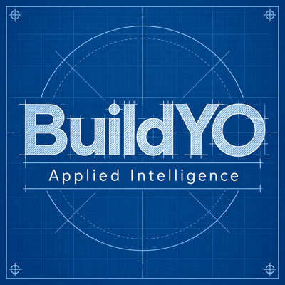
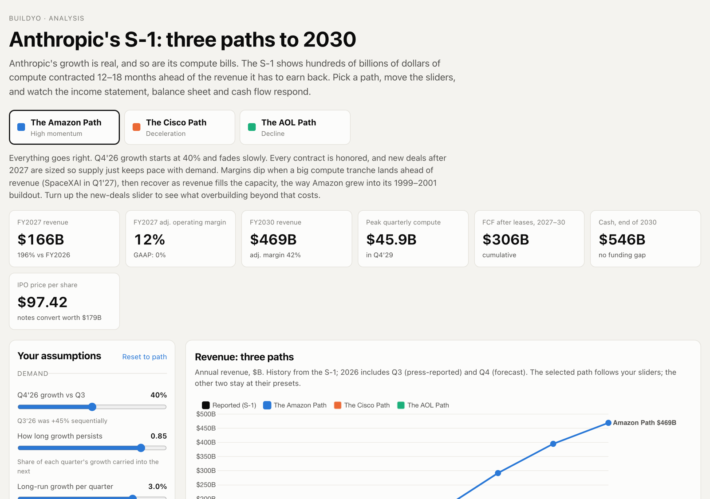

<p align="center"></p>

# BuildYO: Anthropic S-1 Financial Model

A quarterly three-statement financial model of Anthropic, PBC, built from its Form S-1 (filed October 26, 2026). It forecasts the income statement, balance sheet and cash flow through 2030 under three scenarios (the Amazon, Cisco and AOL paths) and checks that the balance sheet ties every quarter. It also produces an Excel workbook and an interactive slider website. This is the companion code to the BuildYO article **[Build Your Own ANT Financial Model in Minutes](https://onabetternote.substack.com/p/build-your-own-ant-financial-model)**: the article explains why and how it was built with an AI coding agent, and this repo lets you run it yourself.

**Live site:** https://ant-s1-scenarios.vercel.app



## Prerequisites

- [Node.js](https://nodejs.org) 18 or newer (runs the model engine)
- [Python](https://www.python.org) 3.10 or newer (builds the data and the Excel workbook)
- Git, and a terminal

## Setup

1. `git clone https://github.com/BuildYOAI/buildyo-ant-financial-model.git`
2. `cd buildyo-ant-financial-model`
3. `python3 -m venv .venv` and then `source .venv/bin/activate` (on Windows: `.venv\Scripts\activate`)
4. `pip install -r requirements.txt`

The model engine uses plain Node.js with no packages, so there is no `npm install` step.

## Run it

```bash
python3 scripts/build_historicals.py   # S-1 figures -> data/historicals.json
node model/run.mjs                     # runs all three scenarios, checks the balance sheet ties
python3 scripts/build_workbook.py      # -> ANT_Financial_Model.xlsx
bash scripts/build_site.sh             # copies the engine and data into site/
python3 -m http.server 8000 --directory site
```

Then open http://localhost:8000 in your browser. Press Ctrl-C in the terminal to stop the server.

To change the scenarios, edit `model/assumptions.json` and run the last four commands again.

## What you get

- **Console summary** from `node model/run.mjs`: quarterly and annual revenue, compute, margins, cash flow and liquidity for each scenario, ending with `All scenarios: balance sheet ties every quarter.`
- **`data/forecast.json`**: every forecast line for every scenario.
- **`ANT_Financial_Model.xlsx`**: historicals, assumptions and forecasts in one workbook, with charts.
- **The slider site** (`site/`): pick a path, move the sliders, and watch all three statements respond.

## How it's organized

| Path | What it is |
|---|---|
| `scripts/build_historicals.py` | S-1 figures, transcribed by hand. Every number carries a source flag: `s1`, `derived`, `press` or `est`. |
| `model/assumptions.json` | Scenario presets and slider ranges. Notes in `_note` / `_bud` fields record why each choice was made. |
| `model/engine.js` | The forecasting engine. The same file runs in Node and in the browser. |
| `model/run.mjs` | Runs every scenario and fails loudly if any subtotal or the balance sheet is off. |
| `scripts/build_workbook.py` | Builds the Excel workbook. |
| `site/` | The static website (HTML, CSS, JavaScript, Chart.js). |
| `scripts/fetch_s1.py` | Optional: downloads the S-1 itself from SEC EDGAR so you can check the numbers. |

### Checking the numbers against the filing (optional)

The S-1 is about 15 MB, so it isn't in the repo. SEC EDGAR asks every automated download to identify itself, so copy `.env.example` to `.env`, put your name and email in `SEC_USER_AGENT`, then run `python3 scripts/fetch_s1.py`. The filing lands in `source/`.

## Caveats

The Q3 2026 figures are press-reported or estimated, not from the S-1, and are flagged as such. The forecasts are scenarios, not predictions. This is not investment advice.

Provided as-is for learning. Fork it, change the assumptions, and point it at a different filing.

## License

MIT. See [LICENSE](LICENSE).

---

Bud Westmont / BuildYO
